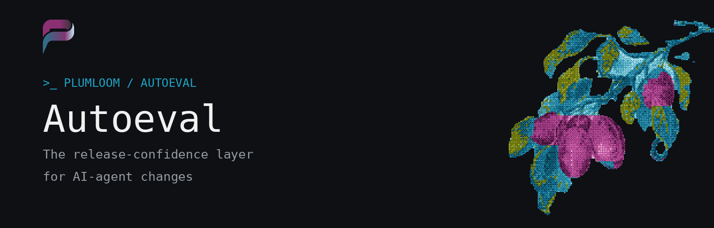
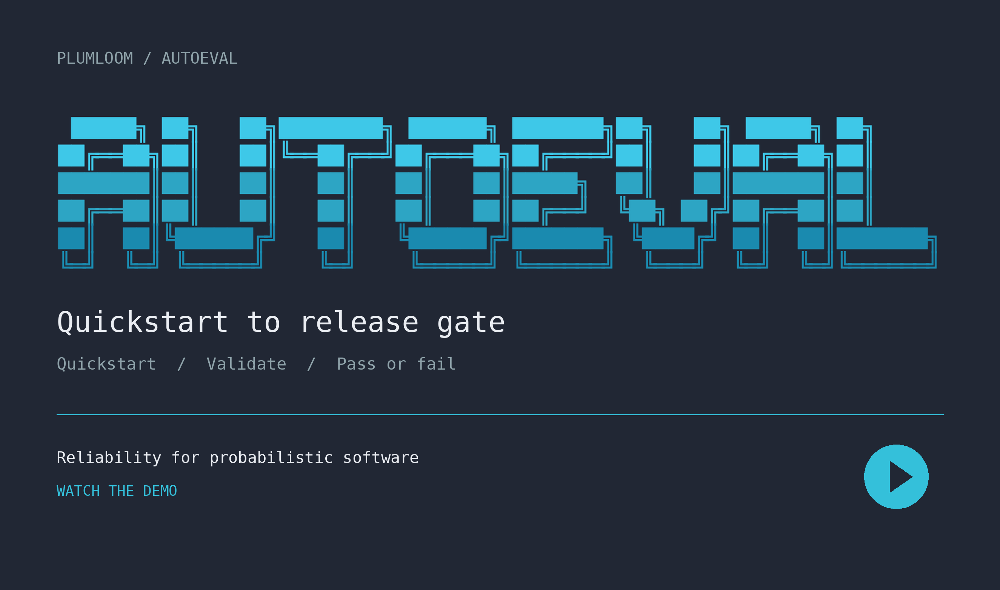
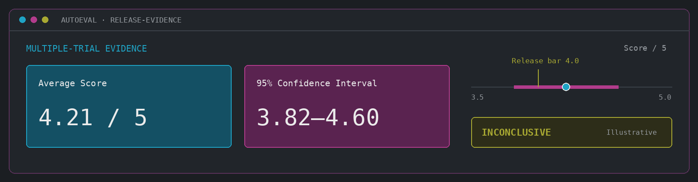
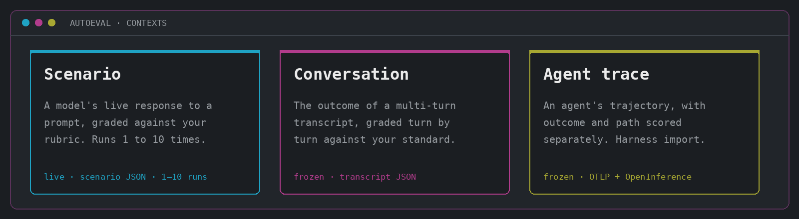

<p align="center">
  <picture>
    <source media="(prefers-color-scheme: light)" srcset="assets/banner-light.png" />
    
  </picture>
</p>

<p align="center">
  <a href="https://www.npmjs.com/package/@plumloom/cli"></a>
  <a href="LICENSE"></a>
  
  
  
</p>

<p align="center">
  <code>&gt;_</code>
  <a href="docs/public/docs-home.md"><b>Docs</b></a> ·
  <a href="docs/public/quickstart.md"><b>Quickstart</b></a> ·
  <a href="docs/public/commands.md"><b>Commands</b></a> ·
  <a href="https://plumloom.ai/free-pilot"><b>Free Pilot</b></a> ·
  <a href="https://plumloom.ai"><b>plumloom.ai</b></a>
</p>

## Demo

[](https://vimeo.com/1237844316)

Quickstart, validate the setup, and see passing and failing release gates.

---

**Autoeval** is an open-source CLI and MCP server that turns committed evaluation files into versioned, gated checks on AI-agent behavior, scored by the Plumloom backend. It runs from your terminal, your CI, or your coding agent.

> [!NOTE]
> **A single evaluation tells you what happened. Repeated evaluation tells you what would happen again.**
>
> LLM outputs and judge scores vary between runs, so one passing score is one sample. Autoeval reports reliability evidence — confidence intervals and consistency statistics — so a release decision rests on more than a single number.

<p align="center">
  
</p>

## What you can evaluate

<p align="center">
  
</p>

|                                                                       | Scenario | Conversation | Agent trace |
| --------------------------------------------------------------------- | :------: | :----------: | :---------: |
| **Supported evaluation context**                                      |    ✅    |      ✅      |     ✅      |
| **Multiple trials** — confidence intervals and consistency statistics |    ✅    |      —       |      —      |

> [!IMPORTANT]
> Multiple trials and statistical reliability evidence apply to **scenario evaluations**. Autoeval also supports conversation and agent-trace evaluation contexts.

## Where it runs

|                         |                                                                                                                  |
| ----------------------- | ---------------------------------------------------------------------------------------------------------------- |
| **`>_ CLI`**            | Author, validate, and run eval files; read scored results from the terminal.                                     |
| **`⑂ CI release gate`** | A suite manifest lists evals and thresholds. `autoeval suite gate` exits non-zero on anything other than `PASS`. |
| **`◇ Coding agents`**   | A local stdio MCP server exposes the same action layer as the CLI.                                               |
| **`⚿ AI providers`**    | Connect OpenAI or Together.ai so Plumloom can run evaluations.                                                   |

<p align="center">
  
</p>

Eval files and the suite manifest are the only inputs you author and commit. Autoeval submits runs to Plumloom, reads back scored results, and the gate turns them into a CI pass/fail.

## Quickstart

**Requirements:** Node.js 22.13+ and a Plumloom CLI key (`pl_sk_…`). pnpm 11 only if building from source.

1. [Connect an AI provider](https://app.plumloom.ai/ai-providers) (OpenAI or Together.ai).
2. [Create a Plumloom API key](https://app.plumloom.ai/api-keys).

```bash
npm install --global @plumloom/cli
autoeval login
autoeval quickstart
```

`quickstart` resolves a workspace and judge model, grades a bundled sample end to end, and prints the result. Autoeval connects to `https://api.plumloom.ai` automatically. → [Quickstart guide](docs/public/quickstart.md)

<details>
<summary><b>Build from source</b></summary>

```bash
pnpm install --frozen-lockfile && pnpm build
```

In the examples below, replace `autoeval` with `node packages/cli/dist/cli.js` when running from this repository.
</details>

## File-driven evaluation

An evaluation file uses the configured-run JSON accepted by `autoeval eval validate`. Artifact and reference-document paths resolve relative to the evaluation file.

```json
{
  "methodology": { "judgeModelId": "<judge-model-id>", "evaluatorInstructions": "..." },
  "configuration": {
    "contextName": "Support conversation",
    "contextType": "conversation",
    "artifactFile": "./data/conversation.json",
    "referenceDocumentFiles": ["./policy/refunds.md"]
  }
}
```

```bash
autoeval eval validate --input support.autoeval.json
autoeval eval create-from --workspace <workspace-id> --input support.autoeval.json --run
```

Model-ID fields take UUIDs; copy enabled IDs from `autoeval models`. → [Write and run your own evaluation file](docs/public/examples/write-and-run-your-own-eval.md)

## Gate a release in CI

A suite manifest names a workspace, lists evaluation files, and declares release thresholds.

```yaml
workspace: <workspace-id>
gate:
  minOverall: 4.0
  minScenario: 3.5
evals:
  - ./evals/refund-policy.autoeval.json
  - file: ./evals/support-conversation.autoeval.json
    gate:
      metrics:
        factuality: 4.0
        relevance: 3.8
```

```bash
autoeval doctor     --manifest autoeval.suite.yaml   # read-only pre-flight
autoeval suite run  --manifest autoeval.suite.yaml   # run, no release judgment
autoeval suite gate --manifest autoeval.suite.yaml   # apply thresholds
```

| Verdict   | `PASS` | `FAIL` / `INCONCLUSIVE` | `ERROR` |
| --------- | :----: | :---------------------: | :-----: |
| Exit code |  `0`   |           `1`           |   `5`   |

<details>
<summary><b>CI setup details</b></summary>

Commit the manifest, every referenced eval file, and any artifacts or reference documents those evals load. Start from [`examples/suite/autoeval.suite.yaml`](examples/suite/autoeval.suite.yaml) and its fixtures under [`examples/smoke/fixtures/`](examples/smoke/fixtures/), then use `autoeval workspace list` and `autoeval models` to replace the synthetic IDs.

Copy [`.github/workflows/autoeval-suite-gate.yml.example`](.github/workflows/autoeval-suite-gate.yml.example) into your repository for a ready-to-use workflow. See [Gate a release in CI](docs/public/examples/gate-a-release-in-ci.md) and [Release gating for CI](docs/public/release-gating.md).

For same-repository pull requests, the example workflow also updates one context-aware Autoeval Reliability Report comment per suite and matrix job, showing the gate verdict alongside available Standard, Judgment, and Repeatability evidence. Comment failures never replace the gate verdict or exit code. Fork pull requests are excluded because they do not receive repository secrets.
</details>

<details>
<summary><b>Common commands</b></summary>

```text
autoeval workspace list
autoeval models
autoeval results <evaluation-id> <run-id>
autoeval --json results <evaluation-id> <run-id>
```

See the [command guide](docs/public/commands.md), [CLI reference](docs/public/cli-reference.md), [developer guide](docs/public/developer-guide.md), and [`.env.example`](.env.example). Smoke workflows: [`examples/smoke/`](examples/smoke/) · sample configs: [`examples/evals/`](examples/evals/).
</details>

## Use it from your coding agent

**MCP server** — a local stdio server exposing the same action layer as the CLI. Credentials resolve from `AUTOEVAL_API_KEY`, then the OS credential store; it never prompts. → [MCP guide](docs/public/mcp.md) · [Codex & Claude Code](docs/public/integration-codex-and-claude-code.md)

**Claude Code plugin**

```bash
claude plugin marketplace add AlchemyInCode/plumloom-autoeval-oss
claude plugin install plumloom-autoeval@plumloom
```

**Gemini CLI extension** (skill-only for now: install and trigger supported, end-to-end execution not yet)

```bash
gemini extensions install https://github.com/AlchemyInCode/plumloom-autoeval-oss
```

→ [Agent skill guide](docs/public/integration-agent-skill.md) · [Security and permissions](docs/public/agent-skill-security.md)

<!-- Kiro's power registry asks for a privacy policy link and a support contact in the README. -->

## Free Autoeval Pilot

> [!TIP]
> **Limited to ten teams.** Complimentary hands-on onboarding, evaluation support, and model access. Applications are considered in the order received.
> **[Sign up for the Free Pilot →](https://plumloom.ai/free-pilot)**

## Documentation

| Get started                                       | Integrate                                                               | Operate                                         |
| ------------------------------------------------- | ----------------------------------------------------------------------- | ----------------------------------------------- |
| [Docs home](docs/public/docs-home.md)             | [MCP server](docs/public/mcp.md)                                        | [Release gating](docs/public/release-gating.md) |
| [Quickstart](docs/public/quickstart.md)           | [Codex & Claude Code](docs/public/integration-codex-and-claude-code.md) | [Troubleshooting](TROUBLESHOOTING.md)           |
| [Command guide](docs/public/commands.md)          | [Agent skill](docs/public/integration-agent-skill.md)                   | [Security policy](SECURITY.md)                  |
| [Developer guide](docs/public/developer-guide.md) | [Agent skill security](docs/public/agent-skill-security.md)             | [Contributing](CONTRIBUTING.md)                 |
| [CLI reference](docs/public/cli-reference.md)     | [DeepSeek Harness](docs/public/integration-deepseek-harness.md)         |                                                 |

## Support

- Privacy policy: [Plumloom Privacy Policy](https://plumloom.ai/privacy-policy)
- Support: [support@plumloom.ai](mailto:support@plumloom.ai)

---

<p align="center">
  &nbsp;&nbsp;<sub><code>&gt;_ PLUMLOOM</code> &middot; Reliability for probabilistic software &middot; Apache-2.0</sub>
</p>
